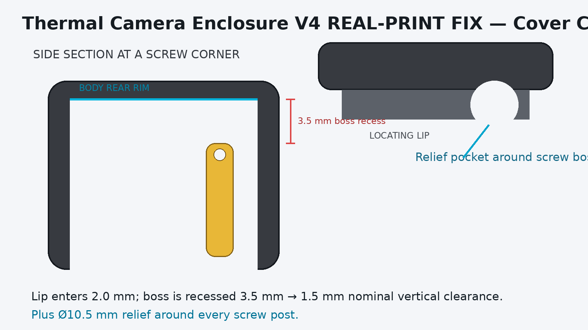
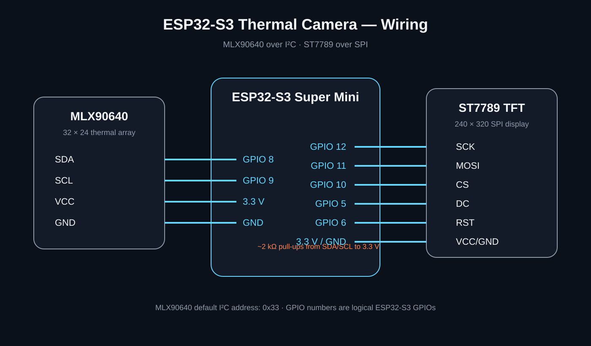
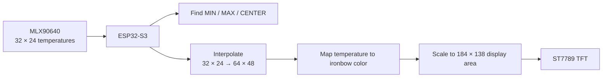

# ESP32-S3 Thermal Camera with MLX90640

A compact handheld thermal-imaging project built around an **ESP32-S3 Super Mini**, an **MLX90640 32×24 thermal array**, an **ST7789 color TFT**, and a custom 3D-printed enclosure.

The goal is not to imitate a high-resolution commercial thermal camera. The project is designed as a practical **relative hotspot finder** for electronics: scan a low-voltage PCB, see where heat is concentrated, and use that information as a starting point for troubleshooting.



## What it does

- Reads all **768 temperature measurements** from the MLX90640
- Displays a live thermal heat map on an ST7789 TFT
- Interpolates the 32×24 frame to make it easier to interpret visually
- Keeps the distinction clear: interpolation does **not** add measured thermal detail
- Shows **MIN**, **MAX**, and **CENTER** temperatures
- Draws a center crosshair and a hottest-point marker
- Uses a fixed **20–40 °C** display range in the included firmware
- Runs as a self-contained handheld ESP32-S3 tool
- Includes the tested **V4 REAL-PRINT FIX** enclosure files

## The important limitation

The MLX90640 sensor is physically only:

**32 × 24 = 768 temperature measurements**

The firmware can smooth and enlarge those measurements for the TFT, but the sensor does not suddenly become high resolution. Small components can blend together, and distance reduces the amount of useful spatial detail.

That is why this project is best used for **finding relative hotspots**, not for precision thermography.

## Hardware

- ESP32-S3 Super Mini
- MLX90640 thermal-array module
- ST7789 SPI TFT, 240×320
- 2 × approximately 2 kΩ pull-up resistors for the MLX90640 I2C lines
- Jumper wire / prototype wiring
- USB power
- 3D-printed enclosure from the included V4 files

## Wiring



### MLX90640

| MLX90640 | ESP32-S3 |
|---|---:|
| VCC | 3.3V |
| GND | GND |
| SDA | GPIO 8 |
| SCL | GPIO 9 |

Use approximately **2 kΩ pull-ups** from SDA and SCL to 3.3 V. The sensor's default I2C address is `0x33`.

### ST7789 TFT

| ST7789 | ESP32-S3 |
|---|---:|
| VCC | 3.3V |
| GND | GND |
| SCK / CLK | GPIO 12 |
| MOSI / SDA | GPIO 11 |
| CS | GPIO 10 |
| DC | GPIO 5 |
| RST / RES | GPIO 6 |
| BL / LED | 3.3V if exposed |
| MISO | Not connected |

Full wiring notes: [docs/WIRING.md](docs/WIRING.md)

## Software setup

Install the ESP32 board package in Arduino IDE, then install these libraries using Library Manager:

- **Adafruit MLX90640**
- **Adafruit GFX Library**
- **Adafruit ST7735 and ST7789 Library**

Open:

```text
firmware/ESP32_S3_Thermal_Camera/ESP32_S3_Thermal_Camera.ino
```

Select an ESP32-S3 board profile suitable for your Super Mini. If your board package does not list the exact module name, `ESP32S3 Dev Module` is commonly used for compatible boards.

Upload the sketch over USB.

## Processing pipeline



### Display behavior

The included firmware uses:

- Original sensor frame: **32×24**
- Interpolated frame: **64×48**
- Thermal image area on TFT: **184×138**
- Fixed display range: **20–40 °C**
- No temporal smoothing
- Ironbow-style color palette
- MIN / MAX / CENTER temperature readouts
- Center crosshair
- Hottest-point marker

The fixed range makes visual comparisons easier from frame to frame. Adjust `DISPLAY_MIN_C` and `DISPLAY_MAX_C` in the sketch if your application needs another temperature range.

## 3D-printed enclosure

The latest enclosure in this repository is **V4 REAL-PRINT FIX**, updated after testing a real full print.


Key V4 dimensions:

- Front body: **90 × 62 × 32 mm**
- Usable internal depth: **27.4 mm**
- Display opening: **55 × 36 mm**
- USB slot: **18 × 9 mm**, centered
- Rear-cover locating-lip depth: **2.0 mm**
- 4 × M2.5 self-tapping screws

V4 also fixes the screw-post printing issue by grounding the posts directly to the enclosure floor.

Full notes: [docs/ENCLOSURE.md](docs/ENCLOSURE.md)

## Real-world tests

The project was designed around four useful tests:

1. **Hand / warm object** — proves the sensor can show large temperature differences clearly.
2. **Distance / resolution** — shows why a 32×24 array becomes less useful as the target gets smaller in the frame.
3. **Electronics hotspot** — scans a safe low-voltage board for warmer regions.
4. **Raw vs interpolated** — demonstrates that a smoother image is easier to read but still contains only 768 measured points.

See [docs/TESTS.md](docs/TESTS.md).

## Thermal-imaging accuracy

Different surfaces emit and reflect infrared energy differently. A shiny metal surface can therefore produce a different apparent temperature from a matte surface even when their actual temperatures are similar.

This build should be treated as a **hotspot-finding and comparison tool**, not a calibrated precision temperature instrument.

More detail: [docs/THERMAL_IMAGING_NOTES.md](docs/THERMAL_IMAGING_NOTES.md)

## Project structure

```text
ESP32-S3-Thermal-Camera-MLX90640/
├── firmware/
│   └── ESP32_S3_Thermal_Camera/
│       └── ESP32_S3_Thermal_Camera.ino
├── docs/
│   ├── WIRING.md
│   ├── TESTS.md
│   ├── THERMAL_IMAGING_NOTES.md
│   ├── ENCLOSURE.md
│   ├── wiring_diagram.svg
│   └── enclosure_preview.png
├── enclosure/
│   └── V4_REAL_PRINT_FIX/
│       ├── STL files
│       ├── STEP files
│       ├── fit-test parts
│       ├── source generator
│       ├── print guide
│       └── validation report
├── GITHUB_UPLOAD_GUIDE.md
├── LICENSE
├── .gitignore
└── README.md
```

## Notes

- The firmware in this repository is a clean implementation matching the documented project wiring and display behavior.
- ESP32-S3 Super Mini boards can have different physical pin layouts depending on the manufacturer. Follow the GPIO numbers rather than assuming every board has the same pin order.
- If the MLX90640 is unstable at 1 MHz I2C, lower the I2C clock to 400 kHz in the sketch.

## License

MIT License. See [LICENSE](LICENSE).

---

**InnoCircuitsLab** — practical ESP32, Arduino, Raspberry Pi and electronics projects.
